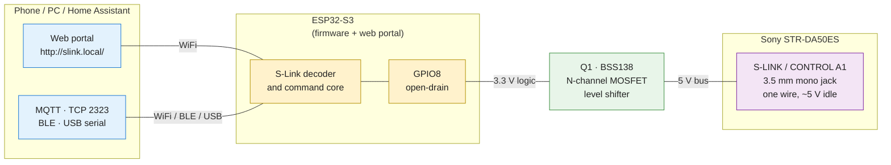
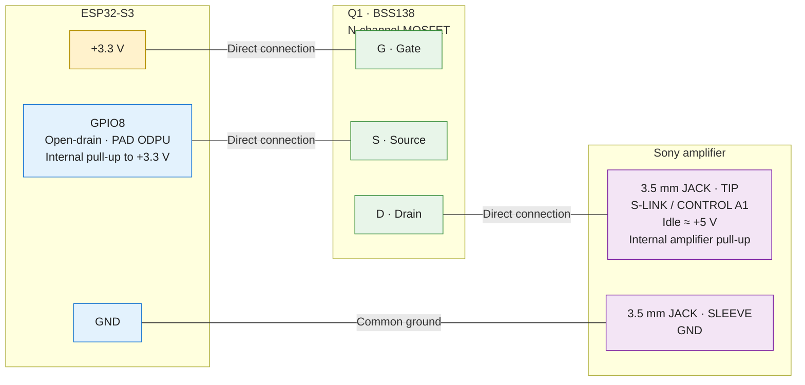
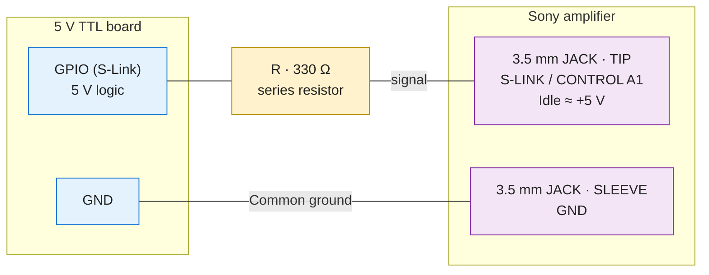
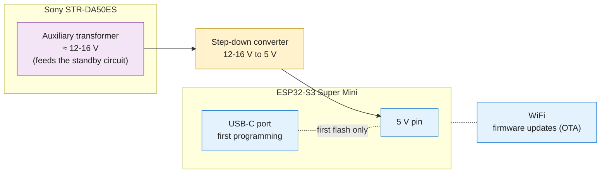

# Connecting an ESP32 to the S-Link (CONTROL A1) jack of a Sony amplifier


**Unit tested: Sony STR-DA50ES** (replies "STR-DA50ES" to `C0 6A`). Board used:
ESP32-S3 (same code for ESP32-C3 Super Mini).

The jack on the back, marked **S-LINK / CONTROL A1 (II)**, is a **3.5 mm mono jack** (tip = signal, sleeve = ground). The bus is single-wire,
bidirectional, open-collector with a pull-up inside the amplifier (~5 V idle on the STR-DA50ES). Two ways to connect it:



**A. ESP32 (3.3 V GPIO): one N-channel MOSFET** (e.g. BSS138), bidirectional and non-inverting (0 V on the ESP32 is 0 V on the Sony and vice versa):



How the single MOSFET passes the bus in both directions (the gate is held at 3.3 V, so the transistor conducts as soon as the source goes below it):

| Situation | What happens | Level on the ESP32 / on the Sony |
|---|---|---|
| Idle | nobody pulls: the transistor is off (V<sub>GS</sub> = 0); each side sits at its own pull-up | 3.3 V / ≈ 5 V |
| The ESP32 sends a mark | the GPIO pulls the source low: V<sub>GS</sub> = 3.3 V, the transistor conducts and drags the drain (the bus) low | 0 V / 0 V |
| The amplifier (or another device) pulls the bus low | the body diode pulls the source low, V<sub>GS</sub> rises, the transistor conducts: the ESP32 sees the mark | 0 V / 0 V |

| MOSFET | Connected to |
|---|---|
| Gate (G) | 3.3 V of the ESP32 |
| Source (S) | the S-Link GPIO of the ESP32 (default GPIO8, `SLINK <gpio>`), with its pull-up to 3.3 V (internal one: `PAD ODPU`, default) |
| Drain (D) | jack tip (S-Link); jack sleeve to GND |

**B. 5 V TTL GPIO (not for a 3.3 V ESP32): direct, through 330 Ω**



```
  Jack 3.5 mm mono                 GPIO 5 V
  ┌─────────────┐
  │ TIP    ─────┼──[ 330 Ω ]──────── GPIO (S-Link)
  │ SLEEVE ─────┼────────────────── GND
  └─────────────┘
```

The jack carries only the signal and ground: nothing is taken from it (see [Powering the board](#powering-the-board)). A 3.3 V ESP32 wired as in B (as the author did on the DA50ES, which works) is **outside the chip's
specification** because of the 5 V idle level; prefer A (the MOSFET variant has not been measured on the author's bench).

## Powering the board

The board can be powered in two ways; both work with the S-Link wiring above.

- **From USB**, with any 5 V supply or charger: the simplest solution, and the one used to flash the board.
- **From the amplifier.** The author reports that the STR-DA50ES has a small **auxiliary transformer** whose output is about **12–16 V** and which feeds the **standby circuit**: it stays powered with the amplifier in standby, which is what the ESP32 needs to receive the "power on" command. A **step-down (buck) converter to 5 V** is required to feed the **ESP32-S3 Super Mini** module (its 5 V pin): never connect the 12–16 V directly to the module. Measure the real voltage on your unit before connecting anything.



**Safety.** The supply of the amplifier is connected to the mains: work inside it only if you know how to, with the unit unplugged, and protect the tap (e.g. a small fuse). Do not feed the module from the converter and from USB at the same time (the two 5 V sources would be tied together): when you connect the USB cable, disconnect the converter, or power the board from USB only.

**Programming.** The module has a **USB** port, used for the **initial programming** (`pio run -e esp32s3 -t upload`, or the factory image of the release written with `esptool.py`: see the README). Once the firmware is installed, the module can be **updated over WiFi** (OTA), without opening the amplifier again: from the portal (Settings › Firmware update), with `OTA UPDATE`, or by pushing a `.bin` with `tools/ota_push.py` after `OTA PUSH ON` (see the README, *Firmware update over WiFi*).

## Verified in the field
- With the direct 330 Ω wiring (B, on a 3.3 V ESP32) the STR-DA50ES **switched on** with `C0 2E` and replied
  with status frames (`C8 2E`, `C8 70 ..`, `C9 ..`, `CB ..`), all decoded by the firmware.
- `C0 6A` (name) → `C8 6A "STR-DA50ES"`. The tuner (`C1`) replies "not available"
  and the surround (`C3`) "error": this is normal for this model/state.
- Amplifier ID that works: **0xC0** (replies `C8`). The code `70` (given for the
  DA1000ES) **produced no reply** with this unit.

## Notes
- Measure the idle voltage between tip and sleeve (unit on or in standby): ≤ 3.6 V → direct connection is within specification; ~5 V → use A.
- Sources: [Bradley Univ. S-Link gateway](https://cegt201.bradley.edu/projects/proj2001/sonyntwk/SLink.PDF), [Ircama/Sony_SLink](https://github.com/Ircama/Sony_SLink),
  [hifi-wiki Control A1](https://hifi-wiki.com/index.php/Control_A1/A1II).
- `PAD OD` switches the internal pull-up off (external pull-up), `PAD PP` makes the pin push-pull (3.3 V bus only, never on the 5 V bus); the choice is
  saved and available in the web interface (Settings › S-Link diagnostics).
- If you hear hum (ground loop PC ↔ amplifier), use a USB isolator or optocouplers
  (the Bradley gateway isolates the bus this way).

## Protocol (timing)

Line held **low** for the mark, then high for 600 µs:

| Element | Low | High |
|---|---|---|
| Sync | 2400 µs | 600 µs |
| Bit 1 | 1200 µs | 600 µs |
| Bit 0 | 600 µs | 600 µs |

Bytes MSB first; frame = sync + byte (device, command, parameters). Wait for the line to be free
for ≥ 3 ms before transmitting, ~30–45 ms between commands. There is no arbitration: in case of collision
it is best to repeat (`REPEAT 2`). The first byte is `nnnn X yyy`: family, "reply" bit
(1 = reply from the unit), sub-device (0 amplifier, 1 tuner, 3 surround).

## Useful commands (amplifier, ID C0)
- `C0 2E` switches on, `C0 2F` switches off, `C0 06`/`C0 07` mute on/off, `C0 14`/`C0 15` volume up/down,
  `C0 50 SS` selects the source (SS: 02 CD, 17 TV, 19 DVD...), `C0 6A` name.
- After a volume command wait a few ms (3–1960 ms according to Ircama).
- The firmware starts with a default ID of **0xC0** (`DEV <hex>` to change it); the mnemonic
  commands (`PWRON`, `VOLUP`...) use that ID.

## Pins
Default: **GPIO8** for the S-Link and **GPIO48** for the LED (on many S3 boards GPIO48 is an addressable
RGB LED: a simple on/off might not light it). Can be changed at runtime with
`SLINK <gpio>` and `LED <gpio>`, or in `menuconfig`. Avoid the strapping and USB pins
(ESP32-C3: GPIO2/8/9, GPIO18/19; ESP32-S3: GPIO0/3/45/46, GPIO19/20).

## First test
1. Measure the voltage (see above), make the connection, open the COM port (wait ~1 s: the board resets).
2. `LOOPBACK ON` + `C0 6A`: you should see your own frame again as `RX` (the line is healthy), then the reply `C8 6A ...`.
3. `LOOPBACK OFF`, change the volume from the front panel: decoded `RX ..` lines should appear.
4. `PWRON` / `PWROFF`, `VOLUP`, `VOLDN`.

## Test commands to identify the pin with the multimeter

- `BLINK HIGH 500 LOW 500 60`: the bus pin goes high for 500 ms and low for 500 ms, 60 times.
  `BLINK OFF` stops it immediately. With the multimeter (DC V) between the pin and GND you see high / 0 V alternating.
- `LEVEL LOW` / `LEVEL HIGH` / `LEVEL OFF`: holds the pin steady (for static measurements).
- `LED <gpio>` (or `LED <gpio> INV` if active-low, `LED OFF`): the LED lights every time
  the S-Link line is low, so it blinks with incoming and outgoing traffic.
- "HIGH" means the pin is released (open-drain): with the pin disconnected the multimeter reads almost
  3.3 V from the internal pull-up, but slightly less if the multimeter loads the line.
